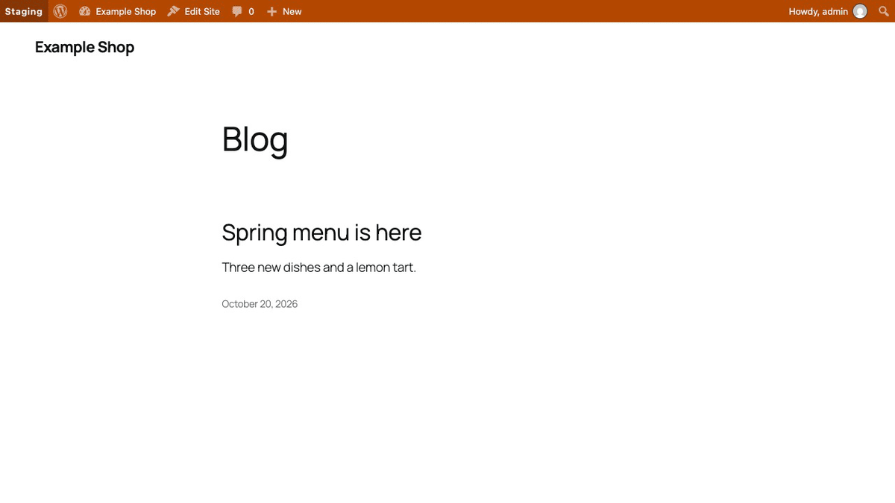
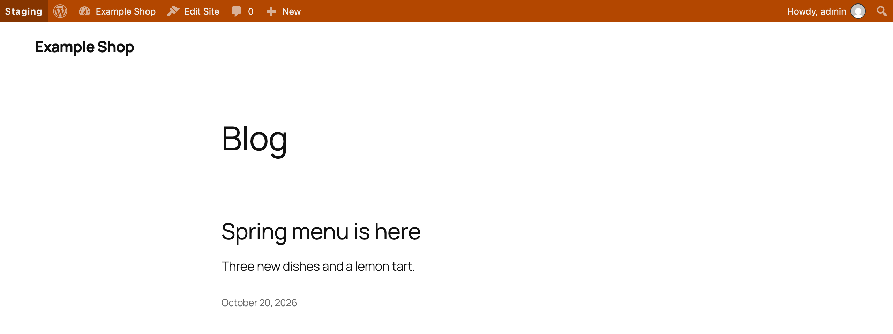
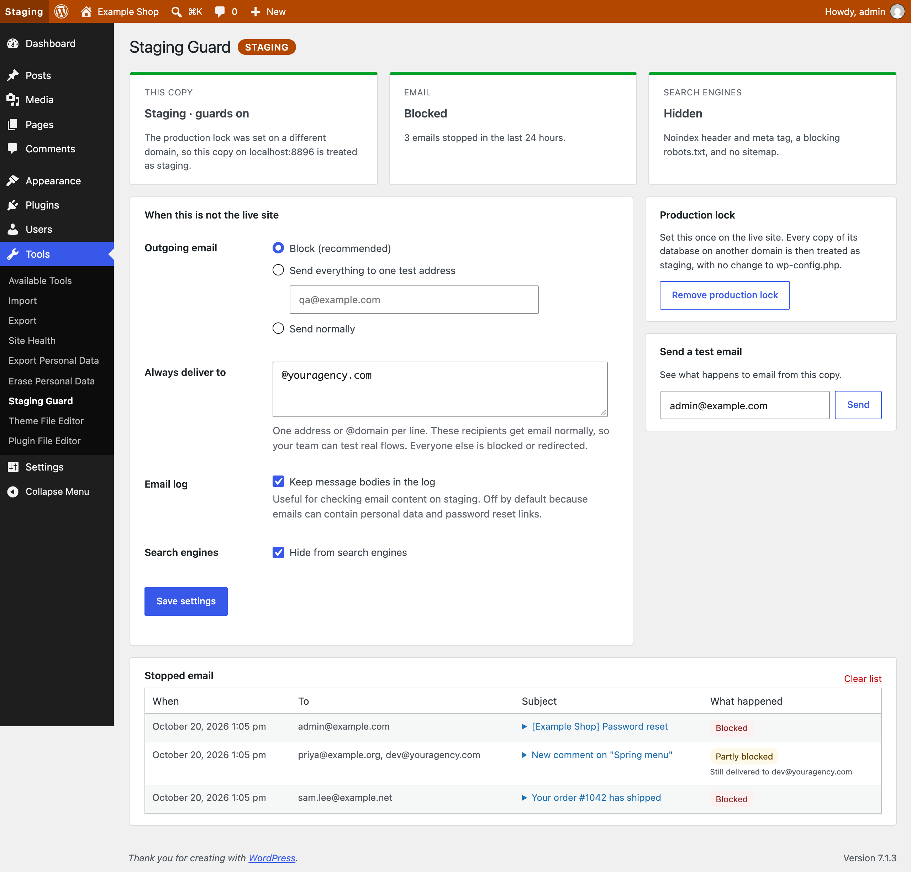

<p align="center"></p>

<h1 align="center">Staging Guard</h1>

<p align="center">
  <a href="https://playground.wordpress.net/?blueprint-url=https://raw.githubusercontent.com/aryanjasala/staging-guard/main/blueprint.json"></a>
  <a href="https://github.com/aryanjasala/staging-guard/releases/latest"></a>
  
  
  <a href="LICENSE.md"></a>
  <br>
  <a href="https://github.com/aryanjasala/staging-guard/actions/workflows/phpcs.yml"></a>
  <a href="https://github.com/aryanjasala/staging-guard/actions/workflows/phpstan.yml"></a>
  <a href="https://github.com/aryanjasala/staging-guard/actions/workflows/unit-tests.yml"></a>
  <a href="https://github.com/aryanjasala/staging-guard/actions/workflows/e2e-tests.yml"></a>
  <a href="https://github.com/aryanjasala/staging-guard/actions/workflows/plugin-check.yml"></a>
</p>

<p align="center">Stop staging copies from emailing real customers or showing up in Google, and color the admin bar so nobody edits the wrong copy.</p>

<p align="center">
  
</p>

---

Every agency has a staging story: a copy of the live database goes to staging and emails every customer, Google indexes it, or someone spends an hour editing it thinking it was live. Staging Guard prevents all three on every copy that is not production, and does nothing on the live site.

> [!NOTE]
> Free and open source under the GPL. No pro version, no upsells, no ads in wp-admin, no tracking. And it stays that way.

## Features

- **Email**: blocked, or sent to one test address with the real recipients in the subject. Cc and Bcc stripped
- **Always deliver to**: addresses and whole domains that still get email, so the team can test real flows
- **Email log** of the last 50 stopped emails, with bodies only if you turn that on
- **Search engines**: `X-Robots-Tag` header, `noindex, nofollow` meta tag, a blocking robots.txt, no sitemap
- **Admin bar** colored by environment, and `[Staging]` at the start of every browser tab title
- **Production lock**: mark the live site once, and every database copy on another domain counts as staging
- **Site Health** check that warns when email could still reach real people

## Install

1. Download `staging-guard.zip` from the [latest release](https://github.com/aryanjasala/staging-guard/releases/latest).
2. In WordPress, go to **Plugins > Add New Plugin > Upload Plugin**, choose the zip and activate it.

Or with WP-CLI:

```sh
wp plugin install https://github.com/aryanjasala/staging-guard/releases/latest/download/staging-guard.zip --activate
```

Needs WordPress 6.6+ and PHP 7.4+. To try it first, the **Try in WordPress Playground** badge opens a throwaway WordPress in your browser with the plugin and some demo content.

## Quick look

Pin the email behavior per environment in wp-config.php, so a database copy cannot change it:

```php
define( 'STAGING_GUARD_MAIL_MODE', 'redirect' );   // block, redirect or allow
define( 'STAGING_GUARD_REDIRECT_TO', 'qa@example.com' );
define( 'STAGING_GUARD_ALLOWLIST', '@youragency.com' );
```

It decides a copy is not live from `WP_ENVIRONMENT_TYPE` when that is set, otherwise from the **production lock**: a hash of the live domain, which survives the search-replace step of a migration.

## Screenshots

<table>
  <tr>
    <td width="50%" valign="top"><br><sub>The coloured admin bar on a staging copy</sub></td>
    <td width="50%" valign="top"> Staging Guard with the email log"><br><sub>Tools > Staging Guard with the email log</sub></td>
  </tr>
</table>

## Documentation

| Doc | What it covers |
| --- | --- |
| [Reference](docs/REFERENCE.md) | Environment detection, constants, the filter and WP-CLI |
| [Development](docs/DEVELOPMENT.md) | Local setup, commands and tests |
| [Contributing](docs/CONTRIBUTING.md) | Pull requests, required checks and PR titles |
| [Releasing](docs/RELEASING.md) | How merged pull requests become releases |
| [Security](docs/SECURITY.md) | Reporting a vulnerability |
| [readme.txt](readme.txt) | What WordPress.org shows, with the FAQ and changelog |

## Project structure

```
staging-guard.php          plugin header and PSR-4 autoloader
src/
├── Plugin.php             creates the services, guards load only when not production
├── Settings.php           the settings option and allowlist parsing
├── Environment.php        environment detection and the production lock
├── Mail/
│   ├── Guard.php          who an email may reach
│   └── Log.php            the stopped email list
├── Search/Robots.php      noindex header and tag, robots.txt, sitemaps
├── Admin/                 settings screen, admin bar and tab titles
├── Health/SiteHealth.php  the Site Health check
└── Cli/Command.php        wp staging-guard
tests/
├── Unit/                  PHPUnit
└── e2e/                   Playwright specs and the Docker site
.wordpress-org/            screenshots
docs/                      reference, development, contributing, releasing
```

## More free plugins

Small plugins that each fill one gap in WordPress, all free with no pro version:

| | Plugin | What it does |
| --- | --- | --- |
|  | [Page Template Usage](https://github.com/aryanjasala/page-template-usage) | See which template every page uses, and fix the pages on a missing template |
|  | [Category & Tag Trash](https://github.com/aryanjasala/category-tag-trash) | A trash for categories, tags and custom terms, with undo and full restore |
|  | [Site Read-Only Mode](https://github.com/aryanjasala/site-read-only-mode) | Read-only mode for WordPress during migrations and deploys |
|  | [Restore Blocks from Revisions](https://github.com/aryanjasala/restore-blocks-from-revisions) | Restore a single block from an old revision, not the whole post |

## License

[GPL-2.0-or-later](LICENSE.md) © Aryan Jasala
